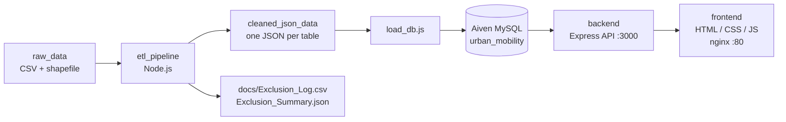

# NYC Urban Mobility Data Explorer

Team4C1 summative project: an end-to-end analytics dashboard for NYC Yellow Taxi trips (January 2019). Raw trip files are cleaned by an ETL pipeline, stored in the team's hosted Aiven MySQL database, served by an Express REST API and explored in a browser dashboard.

## Links

- Repository: [GitHub - Team4C1 Urban Mobility Data Explorer](https://github.com/gunnogere/Team4C1_Summative_Urban_Mobility_Data_Explorer/)
- Team tracker: [Team Participation Sheet](https://docs.google.com/spreadsheets/d/1WCFntWARypndTvvnE96RubS0UG_TBQ_wbSkPMJvA4II/edit?gid=0#gid=0)
- Video walkthrough: [Google Drive folder](https://drive.google.com/drive/folders/1RjtggmX7TIDU65Tzd7HYHVOKduUQpOqr?usp=drive_link)
- Technical report: [Google Drive folder](https://drive.google.com/drive/folders/13K72DA_q3OvyeUffRLacCBH9Fs13zseJ?usp=drive_link)

## 1. Overview

The system:

- ingests raw NYC taxi trips, the zone lookup and the zone shapefile
- cleans and validates records and logs every exclusion
- derives features (duration, speed, fare per mile, rush hour, cross-borough and more)
- stores the result in a relational MySQL schema
- exposes trips, zones and insights through an API
- visualises KPIs, charts, a zone map and a sortable trips table

## 2. Architecture



| Layer | Technology | Folder |
|---|---|---|
| ETL | Node.js, `shapefile`, `proj4` | `etl_pipeline/` |
| Database | MySQL | `database/` |
| Backend API | Node.js, Express, mysql2, Joi, cors, dotenv | `backend/` |
| Frontend | HTML5, CSS3, JavaScript, Chart.js, Leaflet | `frontend/` |

The ETL stages its output as JSON (one file per table) so a failed database load can be repeated without re-cleaning, and the cleaning and database steps can be debugged separately.

## 3. Repository structure

```text
├── algorithms/        # custom algorithm implementation
├── analysis/          # insight scripts and output
├── backend/           # Express API (routers, models, config)
├── database/          # schema.sql, queries.sql, loaders, database README
├── docs/              # exclusion log/summary, algorithm analysis
├── etl_pipeline/      # ETL, DB loader, raw and cleaned data
├── frontend/          # dashboard (index.html, script.js, style.css)
├── start_app.sh       # Ubuntu launcher: backend + local frontend + browser tab
├── setup_db.sh        # optional local MySQL setup + data load + backend start
├── setup_sd_server.sh # optional local MySQL installation and schema setup
├── import_to_omline_db.sh # legacy dump import helper; not needed for normal app use
└── README.md
```

## 4. Database design

Created by `database/schema.sql` (database `urban_mobility`):

| Table | Purpose | Key / relations |
|---|---|---|
| `zones` | 265 taxi zones (borough, zone, service zone) | PK `location_id` |
| `zone_geometries` | centroid, area and GeoJSON for 260 zones | FK `location_id` to `zones` |
| `vendors` | taxi vendors | PK `vendor_id` |
| `payment_types` | payment methods | PK `payment_type_id` |
| `rate_codes` | rate codes | PK `rate_code_id` |
| `trips` | fact table, about 7.59 million rows | FKs to vendors, rate codes, payment types and zones (pickup and drop-off) |

`trips` indexes: `idx_pickup_datetime`, `idx_pu_location`, `idx_do_location`, `idx_hour_dow (pickup_hour, pickup_day_of_week)`.

The schema is for first-time setup. It drops and recreates the tables.

## 5. ETL pipeline

Reads the raw files in `etl_pipeline/raw_data/` (not in git, see the [NYC TLC page](https://www.nyc.gov/site/tlc/about/tlc-trip-record-data.page)) and writes `etl_pipeline/cleaned_json_data/`. Requires Node.js 18+, about 4 GB RAM and about 6 GB disk.

```bash
cd etl_pipeline
npm install
npm run etl        # about 2 minutes, writes cleaned_json_data/ and the docs/ logs
```

**Cleaning rules.** Result: 7,667,792 rows read, **7,590,347 kept, 77,445 excluded**.

- Excluded and logged: malformed rows, invalid timestamps, missing required fields, unknown vendor/payment/location IDs, non-positive or very large fares (over $500) and totals (over $1,000), distance of 0 or over 100 miles, pickups outside January 2019, duration under 30 seconds or over 24 hours, speed over 100 mph, exact duplicates.
- Corrected (set to `null`, trip kept): `passenger_count` outside 1-6, invalid `RatecodeID`, invalid `store_and_fwd_flag`.
- Flagged (kept): unknown zones 264 and 265, and totals that differ from the sum of their parts by more than $1.
- Formats: ISO 8601 NYC local timestamps, money rounded to 2 decimals, integer IDs, boolean flags.
- Known gap: zones 57, 104, 105, 264 and 265 have no polygon in the shapefile.

**Derived features.**

| Feature | Formula |
|---|---|
| `trip_duration_min` | dropoff time minus pickup time |
| `avg_speed_mph` | distance / duration in hours |
| `fare_per_mile` | `fare_amount` / distance |
| `tip_pct` | tip / fare x 100 (card payments only, otherwise `null`) |
| `pickup_hour`, `pickup_day_of_week` (0 = Sunday), `is_weekend` | from pickup time |
| `is_rush_hour` | weekday, 07:00-09:59 or 16:00-19:59 |
| `is_cross_borough` | pickup borough differs from drop-off borough |

Exclusions are listed in `docs/Exclusion_Log.csv` (reason and raw line) and counted in `docs/Exclusion_Summary.json`.

## 6. Run the app (Ubuntu 24)

The dashboard uses the team's hosted Aiven MySQL database. A facilitator does not need to install MySQL, download the trip CSV, run the ETL, or import a database dump. Only `sudo`, a browser, and network access are required; the launcher installs Node.js, npm and nginx with `apt` when they are missing.

### One-command launch

The Aiven connection values are credentials and must be shared with the facilitator through an approved secure channel; they are not committed to Git. Clone the repository, then create `backend/config.env` on the machine that will run the app:

```bash
git clone https://github.com/gunnogere/Team4C1_Summative_Urban_Mobility_Data_Explorer.git
cd Team4C1_Summative_Urban_Mobility_Data_Explorer
nano backend/config.env
```

Put these values in the file:

```dotenv
PORT=3000
DB_HOST=your-service.aivencloud.com
DB_PORT=your_aiven_port
DB_USER=your_aiven_user
DB_PASSWORD=your_aiven_password
DB_NAME=urban_mobility
DB_SSL=true
# Recommended: path to the Aiven CA certificate for server verification.
# DB_SSL_CA=/absolute/path/to/ca.pem
```

Launch the app:

```bash
./start_app.sh
```

The script installs Node.js, npm and nginx if they are missing (Node.js 18+ is required), installs backend packages, starts the API with `npm start`, adds `127.0.0.1 team4c1-mobility.test` to `/etc/hosts`, copies the frontend to `/var/www/team4c1-mobility`, adds an nginx site (`/etc/nginx/conf.d/team4c1-mobility.conf`) that serves it on port 80, and opens a new browser tab at **http://team4c1-mobility.test**. It asks for `sudo` for package installation, `/etc/hosts` and nginx. Because nginx routes by host name, an existing nginx default site on port 80 does not conflict. It does not install or configure a local database. Logs are written under `/tmp`.

The requested `.app` hostname is not used: browsers preload HTTPS enforcement for the `.app` top-level domain, so an HTTP-only local server is upgraded to HTTPS. The underscore in `team4c1_mobility.app` is also not a standards-compliant hostname. The reserved `.test` domain and hyphens provide a local URL that works over HTTP.

For direct backend development, run `cd backend && npm start`. The frontend requests `http://localhost:3000/api` and loads Chart.js, Leaflet, map tiles and fonts from the internet. The first dashboard queries against the full dataset can take a few minutes.

### Optional data rebuild / local database development

The ETL and local MySQL setup remain available for maintainers who need to reproduce the dataset. Follow the [ETL guide](etl_pipeline/README.md), then use `npm run setup-db` and `npm run load` from `etl_pipeline/`, or the optional root scripts. These steps are not part of the facilitator's normal startup flow.

### Quick check

```bash
curl http://localhost:3000/api/zones
curl http://localhost:3000/api/zones/geojson
curl "http://localhost:3000/api/trips?page=1&limit=20"
curl http://localhost:3000/api/insights
```

## 7. API reference

All endpoints are GET requests under `http://localhost:3000/api`.

| Endpoint | Purpose |
|---|---|
| `/trips` | Filtered, sorted and paginated trips with pickup and drop-off zone names |
| `/zones` | Zone names, boroughs and service zones |
| `/zones/geojson` | Zone boundaries as a GeoJSON `FeatureCollection` |
| `/insights` | Summary metrics and chart data |

**Filters** (`/trips` and `/insights`): `date_from`, `date_to` (YYYY-MM-DD, whole day included), `borough` (pickup), `min_fare`, `max_fare` (on `fare_amount`), `min_distance`, `max_distance` (miles). Minimum greater than maximum returns 400.

**Pagination and sorting** (`/trips`): `page` (default 1, max 200), `limit` (default 50, max 200), `sort` (`pickup_datetime`, `pu_zone`, `do_zone`, `trip_distance_miles`, `trip_duration_min`, `fare_amount`), `order` (`ASC` or `DESC`). `trip_id` is the secondary sort key.

**Insights response:** `summary` (total trips, average fare, distance, duration, speed, airport trips, cross-borough trips), `trips_by_hour`, `speed_by_hour`, `fare_by_borough` and `top_pickup_zones`. Insights cover all matching trips, independent of the table page.

**Notes:** filter values go through SQL placeholders and sorting uses an allowlist. Status codes are 200 (including empty results), 400 (invalid parameters or unknown route) and 500 (database failure). The trips response uses the key `messages`, while the other endpoints use `message`.

## 8. Frontend

Plain HTML, CSS and JavaScript dashboard:

- seven KPI cards: trips, average fare, distance, duration, speed, airport trips, cross-borough trips
- four charts: trips by hour, average speed by hour, fare per mile by borough, busiest pickup zones
- filters for date range, pickup borough, distance and fare, with a reset button
- zone map (hover a zone to see its name) and a sortable trips table with a detail pop-up
- responsive layout that collapses to one column on phones

Filtering and sorting are done by the API; there is no file fallback, so the backend must be running.

## 9. Custom algorithm

The custom algorithm lives in `algorithms/merge_sort.py`, with pseudocode, stability, and complexity analysis in [docs/algorithm_analysis.md](docs/algorithm_analysis.md). It uses recursion and loops, not Python's built-in sorting helpers.

## 10. Rubric evidence

| Rubric criterion | Evidence in this submission |
|---|---|
| Backend logic and data handling | ETL rules, exclusions, corrections, flags, derived features and row counts in this README, `etl_pipeline/src/etl.js`, and `docs/Exclusion_Log.csv` / `docs/Exclusion_Summary.json`; validated API filters and pagination in `backend/routers/`. |
| Architecture and database design | Architecture diagram above; normalized dimensions/fact table, foreign keys and indexes in `database/schema.sql`. |
| Frontend and insight presentation | Seven KPIs, four charts, filters, map, and sortable trip table in `frontend/`; frontend usage details in `frontend/README.md`. |
| Algorithm / DSA | Manual merge sort in `algorithms/merge_sort.py`; pseudocode and complexity in `docs/algorithm_analysis.md`. |
| Code quality and reproducibility | Modular ETL, API routers and frontend files; Ubuntu startup steps and per-folder guides. |
| Video walkthrough | [5-minute walkthrough folder](https://drive.google.com/drive/folders/1RjtggmX7TIDU65Tzd7HYHVOKduUQpOqr?usp=drive_link). Ensure the final video explains the architecture, algorithm, dashboard, and findings. |
| Product quality and storytelling | The dashboard connects taxi demand, speed, borough and route patterns. For January 2019, the current summary shows the largest hourly trip count at 18:00 (509,926 trips), while average speed at 17:00 is 10.12 mph versus 18.91 mph at 05:00; the map and filters let viewers investigate where and when these patterns occur. |
| Technical report and reflection | [Technical report folder](https://drive.google.com/drive/folders/13K72DA_q3OvyeUffRLacCBH9Fs13zseJ?usp=drive_link). Include reasoning, insights, architecture, data decisions, challenges, and reflection. |
| Individual effort and AI verification | The [team participation sheet](https://docs.google.com/spreadsheets/d/1WCFntWARypndTvvnE96RubS0UG_TBQ_wbSkPMJvA4II/edit?gid=0#gid=0), Git commit history, and each student's authentic CodeVibe report provide the evidence. Each contributor must understand and disclose AI-assisted work; README content alone cannot establish individual effort or guarantee a grade. |

## 11. Team

| Member | Role | Report section |
|---|---|---|
| Joshua Gunnogere Mulongo | Data Engineer / ETL lead | 1: Problem framing and dataset analysis |
| Moezy | Database and algorithm engineer | 3: Algorithmic logic, pseudo-code and complexity |
| Josue Nsengiyumva | Backend engineer | 2: System architecture and design decisions |
| Didier Abizera | Frontend engineer | 4: Three urban mobility insights and visualisations |

All members share Section 5 (reflection and future work), the 5-minute video walkthrough and a runnable README.

## 12. Deliverables

- GitHub repository with a meaningful commit history and runnable code
- Database schema (`database/schema.sql`) and hosted Aiven database
- PDF technical report (2-3 pages, sections 1-5)
- This README
- 5-minute video walkthrough (architecture, algorithm, dashboard)
- Team participation sheet

## 13. Rules and integrity

1. Missing the video, the report or the README, or non-executable code, results in a zero.
2. At most 20% of the code may be AI-generated; at least 80% must be written by hand. Each student should retain and submit their authentic CodeVibe report with its intact hash, and be ready to explain all AI-assisted files.
3. Custom algorithms must be implemented from scratch with no built-in sorting helpers.
4. Only the team lead edits the participation sheet; other members have comment-only access.
5. All GitHub, tracker and video links must be public and valid before submission.

## 14. Troubleshooting

| Problem | Fix |
|---|---|
| Backend cannot connect | Check Aiven host, port, user, password, database, network access, and `DB_SSL=true` in `backend/config.env`. Use the Aiven CA via `DB_SSL_CA` for certificate verification. |
| `Access denied for user` | Check the Aiven username/password and that the database user is allowed to connect from this network. |
| Dashboard shows "Could not load data from the API" | Start the backend (port 3000) and check `API_URL` in `frontend/script.js`. |
| Insights or trips are slow the first time | The first run over about 7.6 million rows can take minutes. The result is cached afterwards. |
| Zone names empty or `null` | The data was loaded from a `zones.json` made before the zone parsing fix. Re-run `npm run etl` and `npm run load`. |
| `JavaScript heap out of memory` during ETL | Use `npm run etl`, not plain `node`, and close other programs. |
| `max_allowed_packet` error while loading | `sudo mysql -e "SET GLOBAL max_allowed_packet=268435456"`, then load again. |
| Port 3000 already in use | Stop the other process or change `PORT` in `config.env`. |

Per-folder details are in [backend/README.md](backend/README.md), [database/README.md](database/README.md), [etl_pipeline/README.md](etl_pipeline/README.md) and [frontend/README.md](frontend/README.md).
