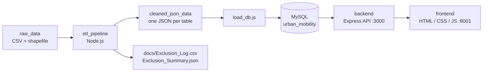

# NYC Urban Mobility Data Explorer

Team4C1 summative project: an end-to-end analytics dashboard for NYC Yellow Taxi trips (January 2019). Raw trip files are cleaned by an ETL pipeline, stored in MySQL, served by an Express REST API and explored in a browser dashboard.

## Links

- Repository: [GitHub - Team4C1 Urban Mobility Data Explorer](https://github.com/gunnogere/Team4C1_Summative_Urban_Mobility_Data_Explorer/)
- Team tracker: [Team Participation Sheet](https://docs.google.com/spreadsheets/d/1WCFntWARypndTvvnE96RubS0UG_TBQ_wbSkPMJvA4II/edit?gid=0#gid=0)
- Video walkthrough: [Google Drive folder](https://drive.google.com/drive/folders/1RjtggmX7TIDU65Tzd7HYHVOKduUQpOqr?usp=drive_link)
- Technical report: [Google Drive folder](https://drive.google.com/drive/folders/13K72DA_q3OvyeUffRLacCBH9Fs13zseJ?usp=drive_link)

## 1. Overview

The system:

- ingests raw NYC taxi trips, the zone lookup and the zone shapefile
- cleans and validates records and logs every exclusion
- derives features (duration, speed, fare per mile, rush hour, cross-borough and more)
- stores the result in a relational MySQL schema
- exposes trips, zones and insights through an API
- visualises KPIs, charts, a zone map and a sortable trips table

## 2. Architecture



| Layer | Technology | Folder |
|---|---|---|
| ETL | Node.js, `shapefile`, `proj4` | `etl_pipeline/` |
| Database | MySQL | `database/` |
| Backend API | Node.js, Express, mysql2, Joi, cors, dotenv | `backend/` |
| Frontend | HTML5, CSS3, JavaScript, Chart.js, Leaflet | `frontend/` |

The ETL stages its output as JSON (one file per table) so a failed database load can be repeated without re-cleaning, and the cleaning and database steps can be debugged separately.

## 3. Repository structure

```text
├── algorithms/        # custom algorithm implementation
├── analysis/          # insight scripts and output
├── backend/           # Express API (routers, models, config)
├── database/          # schema.sql, queries.sql, loaders, database README
├── docs/              # exclusion log/summary, algorithm analysis
├── etl_pipeline/      # ETL, DB loader, raw and cleaned data
├── frontend/          # dashboard (index.html, script.js, style.css)
├── setup_db.sh        # interactive MySQL setup + data load + backend start
├── setup_sd_server.sh # install MySQL and create the database and tables only
├── import_to_omline_db.sh # import database_dump.sql into the hosted database
└── README.md
```

## 4. Database design

Created by `database/schema.sql` (database `urban_mobility`):

| Table | Purpose | Key / relations |
|---|---|---|
| `zones` | 265 taxi zones (borough, zone, service zone) | PK `location_id` |
| `zone_geometries` | centroid, area and GeoJSON for 260 zones | FK `location_id` to `zones` |
| `vendors` | taxi vendors | PK `vendor_id` |
| `payment_types` | payment methods | PK `payment_type_id` |
| `rate_codes` | rate codes | PK `rate_code_id` |
| `trips` | fact table, about 7.59 million rows | FKs to vendors, rate codes, payment types and zones (pickup and drop-off) |

`trips` indexes: `idx_pickup_datetime`, `idx_pu_location`, `idx_do_location`, `idx_hour_dow (pickup_hour, pickup_day_of_week)`.

The schema is for first-time setup. It drops and recreates the tables.

## 5. ETL pipeline

Reads the raw files in `etl_pipeline/raw_data/` (not in git, see the [NYC TLC page](https://www.nyc.gov/site/tlc/about/tlc-trip-record-data.page)) and writes `etl_pipeline/cleaned_json_data/`. Requires Node.js 18+, about 4 GB RAM and about 6 GB disk.

```bash
cd etl_pipeline
npm install
npm run etl        # about 2 minutes, writes cleaned_json_data/ and the docs/ logs
```

**Cleaning rules.** Result: 7,667,792 rows read, **7,590,347 kept, 77,445 excluded**.

- Excluded and logged: malformed rows, invalid timestamps, missing required fields, unknown vendor/payment/location IDs, non-positive or very large fares (over $500) and totals (over $1,000), distance of 0 or over 100 miles, pickups outside January 2019, duration under 30 seconds or over 24 hours, speed over 100 mph, exact duplicates.
- Corrected (set to `null`, trip kept): `passenger_count` outside 1-6, invalid `RatecodeID`, invalid `store_and_fwd_flag`.
- Flagged (kept): unknown zones 264 and 265, and totals that differ from the sum of their parts by more than $1.
- Formats: ISO 8601 NYC local timestamps, money rounded to 2 decimals, integer IDs, boolean flags.
- Known gap: zones 57, 104, 105, 264 and 265 have no polygon in the shapefile.

**Derived features.**

| Feature | Formula |
|---|---|
| `trip_duration_min` | dropoff time minus pickup time |
| `avg_speed_mph` | distance / duration in hours |
| `fare_per_mile` | `fare_amount` / distance |
| `tip_pct` | tip / fare x 100 (card payments only, otherwise `null`) |
| `pickup_hour`, `pickup_day_of_week` (0 = Sunday), `is_weekend` | from pickup time |
| `is_rush_hour` | weekday, 07:00-09:59 or 16:00-19:59 |
| `is_cross_borough` | pickup borough differs from drop-off borough |

Exclusions are listed in `docs/Exclusion_Log.csv` (reason and raw line) and counted in `docs/Exclusion_Summary.json`.

## 6. Setup and run

### Prerequisites

Node.js 18+ and npm, MySQL Server (or MariaDB), and `python3` for serving the frontend. `trips.json` (about 4.5 GB) is not in git, so create it with `npm run etl` or restore the database from a dump.

### Option A: load from the cleaned JSON

```bash
cd etl_pipeline
npm run setup-db   # installs MySQL if needed, creates the DB, tables and app user
npm run load       # loads the JSON files, then verifies row counts
```

`setup-db` asks for a database user and password, saves them to `etl_pipeline/.env` (git-ignored) and can be answered with Enter for defaults. Loading about 7.59 million trips takes several minutes, so do not interrupt it.

Alternatively, from the project root, `./setup_db.sh` does the setup, data load and backend start in one interactive run.

### Option B: install MySQL and create the tables only

Put your credentials in `backend/config.env` (see `backend/config.env.example`), then:

```bash
./setup_sd_server.sh
```

It installs MySQL if missing, creates the database and user, and applies `database/schema.sql`.

### Option C: import a dump into a hosted MySQL

```bash
./import_to_omline_db.sh     # reads database/database_dump.sql
```

Host, port, user, password and database name can be overridden with `DB_HOST`, `DB_PORT`, `DB_USER`, `DB_PASSWORD` and `DB_NAME`. The dump was made from MariaDB, so the script rewrites `uca1400` collations to MySQL-compatible ones on the fly.

### Start the backend

Create `backend/config.env`:

```dotenv
PORT=3000
DB_HOST=localhost
DB_PORT=3306
DB_USER=your_user
DB_PASSWORD=your_password
DB_NAME=urban_mobility
```

```bash
cd backend
npm install
node server.js     # run from backend/: config.env is read from the working directory
```

Expected output:

```text
MYSQL Database is Connected Successfully!
Server is running on PORT 3000
```

On startup the backend runs the unfiltered dashboard queries once to fill an in-memory cache (10-minute lifetime). On the full dataset the first insights result can take a few minutes, after which responses are fast.

### Start the frontend

The frontend is static and needs a web server. From the project root:

```bash
python3 -m http.server 8001
```

Open http://localhost:8001/frontend/. The page reads from `http://localhost:3000/api` (the `API_URL` line at the top of `frontend/script.js`) and also loads Chart.js, Leaflet, map tiles and fonts from the internet.

### Quick check

```bash
curl localhost:3000/api/zones
curl localhost:3000/api/zones/geojson
curl "localhost:3000/api/trips?page=1&limit=20"
curl localhost:3000/api/insights
```

## 7. API reference

All endpoints are GET requests under `http://localhost:3000/api`.

| Endpoint | Purpose |
|---|---|
| `/trips` | Filtered, sorted and paginated trips with pickup and drop-off zone names |
| `/zones` | Zone names, boroughs and service zones |
| `/zones/geojson` | Zone boundaries as a GeoJSON `FeatureCollection` |
| `/insights` | Summary metrics and chart data |

**Filters** (`/trips` and `/insights`): `date_from`, `date_to` (YYYY-MM-DD, whole day included), `borough` (pickup), `min_fare`, `max_fare` (on `fare_amount`), `min_distance`, `max_distance` (miles). Minimum greater than maximum returns 400.

**Pagination and sorting** (`/trips`): `page` (default 1, max 200), `limit` (default 50, max 200), `sort` (`pickup_datetime`, `pu_zone`, `do_zone`, `trip_distance_miles`, `trip_duration_min`, `fare_amount`), `order` (`ASC` or `DESC`). `trip_id` is the secondary sort key.

**Insights response:** `summary` (total trips, average fare, distance, duration, speed, airport trips, cross-borough trips), `trips_by_hour`, `speed_by_hour`, `fare_by_borough` and `top_pickup_zones`. Insights cover all matching trips, independent of the table page.

**Notes:** filter values go through SQL placeholders and sorting uses an allowlist. Status codes are 200 (including empty results), 400 (invalid parameters or unknown route) and 500 (database failure). The trips response uses the key `messages`, while the other endpoints use `message`.

## 8. Frontend

Plain HTML, CSS and JavaScript dashboard:

- seven KPI cards: trips, average fare, distance, duration, speed, airport trips, cross-borough trips
- four charts: trips by hour, average speed by hour, fare per mile by borough, busiest pickup zones
- filters for date range, pickup borough, distance and fare, with a reset button
- zone map (hover a zone to see its name) and a sortable trips table with a detail pop-up
- responsive layout that collapses to one column on phones

Filtering and sorting are done by the API; there is no file fallback, so the backend must be running.

## 9. Custom algorithm

The custom algorithm lives in `algorithms/` (`merge_sort.py`), with its pseudo-code and complexity analysis in `docs/algorithm_analysis.md`. Per the project rules, it is written with plain control structures, without `sort()`, `heapq`, Pandas `.sort_values()` or SQL `ORDER BY`.

## 10. Team

| Member | Role | Report section |
|---|---|---|
| Joshua Gunnogere Mulongo | Data Engineer / ETL lead | 1: Problem framing and dataset analysis |
| Moezy | Database and algorithm engineer | 3: Algorithmic logic, pseudo-code and complexity |
| Josue Nsengiyumva | Backend engineer | 2: System architecture and design decisions |
| Didier Abizera | Frontend engineer | 4: Three urban mobility insights and visualisations |

All members share Section 5 (reflection and future work), the 5-minute video walkthrough and a runnable README.

## 11. Deliverables

- GitHub repository with a meaningful commit history and runnable code
- Database schema and dump (`database/schema.sql`, `database/database_dump.sql`)
- PDF technical report (2-3 pages, sections 1-5)
- This README
- 5-minute video walkthrough (architecture, algorithm, dashboard)
- Team participation sheet

## 12. Rules and integrity

1. Missing the video, the report or the README, or non-executable code, results in a zero.
2. At most 20% of the code may be AI-generated; at least 80% must be written by hand.
3. Custom algorithms must be implemented from scratch with no built-in sorting helpers.
4. Only the team lead edits the participation sheet; other members have comment-only access.
5. All GitHub, tracker and video links must be public and valid before submission.

## 13. Troubleshooting

| Problem | Fix |
|---|---|
| Backend cannot connect | Check that MySQL is running and `backend/config.env` has the right host, port, user, password and database. |
| `Access denied for user` | Wrong password for that host. A local server and a hosted one often have different passwords. |
| `Unknown collation: utf8mb4_uca1400_ai_ci` | The dump came from MariaDB. Use `import_to_omline_db.sh`, which rewrites it. |
| Dashboard shows "Could not load data from the API" | Start the backend (port 3000) and check `API_URL` in `frontend/script.js`. |
| Insights or trips are slow the first time | The first run over about 7.6 million rows can take minutes. The result is cached afterwards. |
| Zone names empty or `null` | The data was loaded from a `zones.json` made before the zone parsing fix. Re-run `npm run etl` and `npm run load`. |
| `JavaScript heap out of memory` during ETL | Use `npm run etl`, not plain `node`, and close other programs. |
| `max_allowed_packet` error while loading | `sudo mysql -e "SET GLOBAL max_allowed_packet=268435456"`, then load again. |
| Port 3000 already in use | Stop the other process or change `PORT` in `config.env`. |

Per-folder details are in `backend/README.md`, `database/README.md`, `etl_pipeline/README.md` and `frontend/README.md`.
